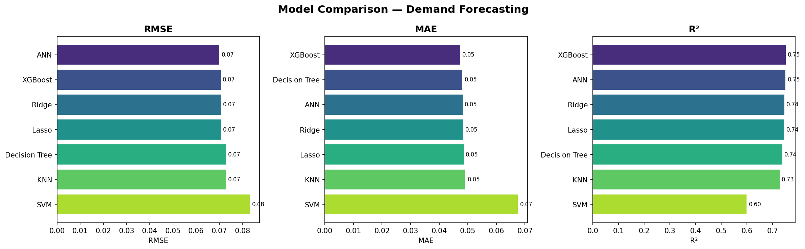
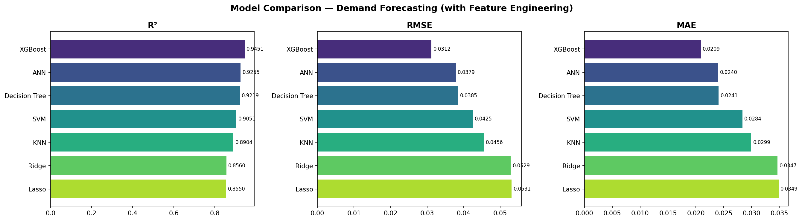
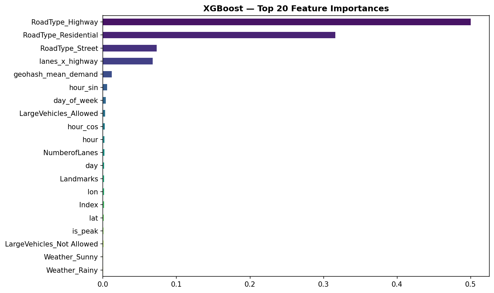
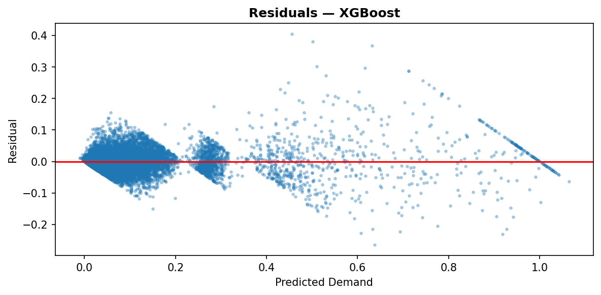

# Gridlock: Geohash-Level Traffic Demand Forecasting

Predicts normalised traffic demand for a geohash cell at a 15-minute time slot, given road and weather context. The repo contains the exploratory notebook, a training script that benchmarks seven regressors, an inference script that writes `submission.csv`, and the trained XGBoost artifacts.

The main result is the effect of feature engineering. With identical models and the same split, adding time, location and interaction features took XGBoost from R² 0.750 to 0.945 on the hold-out set.

## Data

Competition-style CSVs, all included in the repo:

| File | Rows | Contents |
|---|---|---|
| `train.csv` | 77,299 | `geohash`, `day`, `timestamp` (`H:M`, 15-min slots), `demand`, `RoadType`, `NumberofLanes`, `LargeVehicles`, `Landmarks`, `Temperature`, `Weather` |
| `test.csv` | 41,778 | Same columns without `demand` |
| `sample_submission.csv` | 5 | `Index,demand` format |

Some facts from the notebook:
- `demand` lies in (0, 1] with skew 3.73, so the models are trained on `log1p(demand)`.
- Missing values in train: `Temperature` 2,495, `Weather` 797, `RoadType` 600.
- The data has 1,249 unique geohashes in train and 1,190 in test. Ten test geohashes never appear in train.
- Train covers day 48 and day 49 up to 02:00. Test covers day 49 from 02:15 onward, so the real task is predicting the next time window.

## Pipeline

```
train.csv ──(notebook: one-hot RoadType/LargeVehicles/Weather,
             Landmarks->0/1, Temperature mean-fill)──> encoded_df.csv
                                                           │
                                                      train.py
     ┌─────────────────────────────────────────────────────┤
     │ feature engineering                                  │
     │  time: hour, day_of_week, month, is_weekend,         │
     │        is_peak (7-9, 17-19), sin/cos of hour/dow/month│
     │  space: geohash -> lat/lon (pygeohash.decode)        │
     │  interactions: temp x peak, lanes x highway,         │
     │        temp x rainy/snowy/foggy                      │
     │  target encoding: geohash -> mean demand (train only)│
     ├──────────────────────────────────────────────────────┤
     │ 80/20 split, 7 models, metrics + plots               │
     │ retrain XGBoost on all rows                          │
     └──> xgb_model.pkl, gh_map.pkl, feature_cols.pkl
                                                           │
test.csv ──> test.py (same imputation, one-hot and features,
                      column alignment to feature_cols.pkl)
                      ──> expm1(model.predict) ──> submission.csv
```

Details worth noting:
- **Log target.** Models fit `log1p(demand)` and predictions are inverted with `expm1`.
- **Cyclical time encoding.** sin/cos pairs keep 23:45 next to 00:00 for the linear and distance-based models.
- **Leak-aware target encoding.** During evaluation, `geohash_mean_demand` is computed from the training split only. Unseen geohashes get the global mean. The final model recomputes the map on all training rows and pickles it with the fallback in `gh_map.pkl`.
- **Scaled vs unscaled.** Ridge, Lasso, KNN, SVR and the MLP use `StandardScaler` inputs. The decision tree and XGBoost use raw features.
- **Train/serve alignment.** `test.py` adds any column missing from `feature_cols.pkl` as zeros and orders columns to match, so the pickled model always gets its 33 features.

## Results

The split is a random 80/20 split (`random_state=42`, 61,839 / 15,460 rows). RMSE and MAE are measured on the original demand scale after `expm1`. R² is computed on the `log1p` scale. All numbers come from the notebook outputs (`flipkart_gridlock2.ipynb`).

**Before feature engineering** (raw encoded columns only, no time-of-day features):

| Model | RMSE | MAE | R² |
|---|---|---|---|
| XGBoost | 0.0706 | 0.0473 | 0.7502 |
| ANN (MLP) | 0.0701 | 0.0482 | 0.7497 |
| Ridge | 0.0707 | 0.0484 | 0.7447 |
| Lasso | 0.0707 | 0.0485 | 0.7443 |
| Decision Tree | 0.0730 | 0.0481 | 0.7369 |
| KNN | 0.0730 | 0.0492 | 0.7271 |
| SVR | 0.0833 | 0.0675 | 0.5989 |

**After feature engineering** (`train.py` feature set, tuned hyperparameters):

| Model | RMSE | MAE | R² |
|---|---|---|---|
| **XGBoost** | **0.0312** | **0.0209** | **0.9451** |
| ANN (MLP 256-128-64) | 0.0379 | 0.0240 | 0.9255 |
| Decision Tree | 0.0385 | 0.0241 | 0.9220 |
| SVR | 0.0425 | 0.0284 | 0.9051 |
| KNN | 0.0456 | 0.0299 | 0.8904 |
| Ridge | 0.0529 | 0.0347 | 0.8560 |
| Lasso | 0.0531 | 0.0349 | 0.8550 |

For XGBoost, RMSE drops from 0.0706 to 0.0312. Every model gains between 0.11 and 0.31 R², which suggests the features carry most of the improvement.

| Baseline comparison | With feature engineering |
|---|---|
|  |  |



The road-type one-hots and `lanes_x_highway` account for most of the XGBoost gain importance. `geohash_mean_demand` and the hour encodings come next.



## How to run

```bash
pip install -r requirements.txt     # numpy pandas matplotlib seaborn scikit-learn xgboost pygeohash

python train.py    # reads encoded_df.csv; prints the 7-model table, saves the three PNGs
                   # and xgb_model.pkl, gh_map.pkl, feature_cols.pkl
python test.py     # reads test.csv + the pickles; writes submission.csv (Index, demand)
```

Both scripts use relative paths, so run them from the repo root. `encoded_df.csv` is produced by the notebook (cells 33–42) and is already committed. The pickles and `submission.csv` in the repo came from the notebook run.

## Limitations / next steps

- **Optimistic validation.** The 80/20 split is random across time slots, but the real test set is the time window that follows the training data. A time-based hold-out would give a fairer estimate of forecast error. The target encoding during validation also includes each training row's own demand.
- **Timestamp parsing in the scripts differs from the notebook.** The notebook builds a full datetime as `2023-01-01 + day` plus the `H:M` slot. `train.py` and `test.py` call `pd.to_datetime` directly on strings like `"2:15"`. Pandas fills those in with the current date, and in pandas 3 the string `"0:0"` parses to year 1. The hour is still correct, but `day_of_week`, `is_weekend` and `month` depend on when the script runs. Because of this, the shipped model (trained in the notebook) receives different calendar features at inference. Moving one `features.py` into both scripts would fix it.
- **`Index` is used as a feature.** It is a row id that restarts at 0 in `test.csv`, so it means something different at inference. It should be dropped.
- **Imputation mismatch.** In training, rows with missing `RoadType` became all-zero one-hots. `test.py` fills them with the test-set mode instead, which is also fitted on test data.
- No cross-validation and no hyperparameter search. The XGBoost settings were chosen by hand.
- `expm1` can return small negative values (minimum prediction −0.0073). Clipping at 0 would be safer.
- `technical_documentation.docx` reports slightly different numbers from an earlier run (XGBoost R² 0.9436, RMSE 0.0318). The notebook outputs above are the ones to cite.
